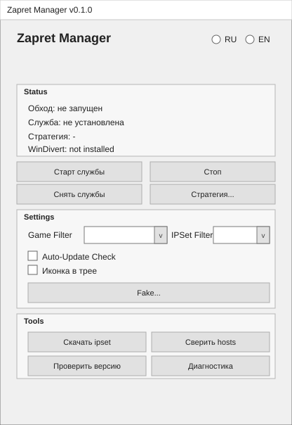

<div align="center">

#  <a href="https://github.com/NONERUN/">NONERUN</a><a href="https://github.com/NONERUN/zapman">/zapman</a> 

**NEW**: Ускорение Telegram Desktop — https://github.com/Flowseal/tg-ws-proxy  
Оригинальный проект: <a href="https://github.com/Flowseal/zapret-discord-youtube">zapret-discord-youtube</a>  
Альтернатива: https://github.com/bol-van/zapret-win-bundle  
Поддержать автора zapret: [bol-van/zapret](https://github.com/bol-van/zapret?tab=readme-ov-file#%D0%BF%D0%BE%D0%B4%D0%B4%D0%B5%D1%80%D0%B6%D0%B0%D1%82%D1%8C-%D1%80%D0%B0%D0%B7%D1%80%D0%B0%D0%B1%D0%BE%D1%82%D1%87%D0%B8%D0%BA%D0%B0)
</div>

> [!CAUTION]
>
> ### ФЕЙКИ
> Я не веду другие страницы и каналы в Telegram / YouTube.  
> Если вы наткнулись на что-то вне этого GitHub от моего лица — **фейк**.

> [!WARNING]
>
> ### АНТИВИРУСЫ
> WinDivert может вызвать реакцию антивируса: это фильтр трафика, не вирус. Добавьте папку в исключения или отключите детект PUA. Подробности — [Проблемы](docs/troubleshooting.md#античит-ругается-на-windivert).

> [!IMPORTANT]
> Файлы в [`bin`](./bin) — официальные [zapret](https://github.com/bol-van/zapret) (`winws.exe`) и [zapret2](https://github.com/bol-van/zapret2) (`winws2.exe`). Тег и SHA256 — [`bin/versions.json`](./bin/versions.json).

## Что это?

**Zapret Manager** — GUI, чтобы запускать официальный zapret (winws) или zapret2 (winws2) на Windows, не собирая флаги руками. Служба, список стратегий, тесты, трей и другие функции. 

Проект основан на базе <a href="https://github.com/Flowseal/zapret-discord-youtube">Flowseal/zapret-discord-youtube</a>


<div align="center">

</div>

## Использование

1. Включите [Secure DNS](docs/usage.md#secure-dns).
2. Скачайте архив со [страницы релизов](https://github.com/NONERUN/zapman/releases/latest) **этого** репозитория.
3. Свойства архива → «Разблокировать» (7-Zip / PeaZip часто не требуют).
4. Распакуйте в путь без кириллицы, пробелов и спецсимволов. Для обновления скопируйте старую папку `user/` в новую распаковку.
5. Запустите `zapman.exe` из архива. Windows спросит права администратора (UAC).

Нужна Windows 10 или новее, x64, с WebView2 (в Windows 10 и 11 он обычно уже стоит). Windows 7 не поддерживается. Консольной версии (CLI) пока нет: всё делается в GUI.

Кнопки, служба, трей (`zapman-tray`), IPSet, игры — [использование](docs/usage.md).

Кнопка **Игры...** включает игровые модули: Sky: Children of the Light, Sker Ritual / Hazard Levels и общий профиль Photon. Их правила идут перед правилами любой стратегии. Подробнее — [Игры](docs/usage.md#игры).

## Документация

- [Использование](docs/usage.md)
- [Проблемы](docs/troubleshooting.md)
- [Окна GUI](docs/ui/index.md)
- [Разработка](docs/dev.md) — JSON → флаги, `go run ./dev/update-zapret`
- [AGENTS.md](AGENTS.md) — правила для агента (раскладка, проверки, что не делать)

## Разработка

Ветка `go` — переписывание на Go. PowerShell-версия — на ветке `main`. Сборка, версия и релиз — [Разработка](docs/dev.md#релиз).

Проверки перед коммитом (в PowerShell флаг `-modfile` — в кавычках):

```text
go tool -modfile=tools/go.mod golangci-lint run ./...
go tool -modfile=tools/go.mod govulncheck ./...
go vet ./...
go test ./...
```

## Поддержка проекта

Поставьте :star: репозиторию (сверху справа).

Материально — [автору zapret](https://github.com/bol-van/zapret?tab=readme-ov-file#%D0%BF%D0%BE%D0%B4%D0%B4%D0%B5%D1%80%D0%B6%D0%B0%D1%82%D1%8C-%D1%80%D0%B0%D0%B7%D1%80%D0%B0%D0%B1%D0%BE%D1%82%D1%87%D0%B8%D0%BA%D0%B0).

## Лицензия

[MIT](LICENSE.txt).
Иконка окон и трея — [`assets/app.LICENSE.txt`](assets/app.LICENSE.txt) (Heroicons, MIT).

## Благодарность

[](https://github.com/NONERUN/zapman/graphs/contributors)

Оригинальный репозиторий: [Flowseal/zapret-discord-youtube](https://github.com/Flowseal/zapret-discord-youtube).
[](https://github.com/Flowseal/zapret-discord-youtube/graphs/contributors)

Отдельная благодарность [bol-van](https://github.com/bol-van) за [zapret](https://github.com/bol-van/zapret) и [zapret2](https://github.com/bol-van/zapret2).
