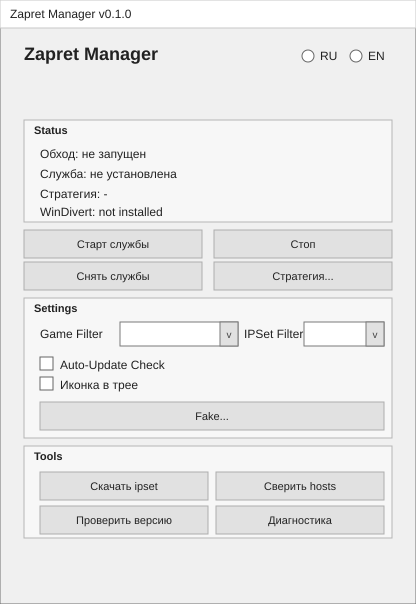
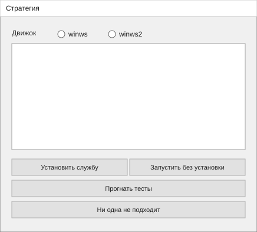
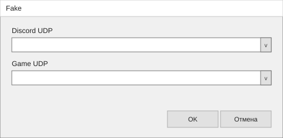
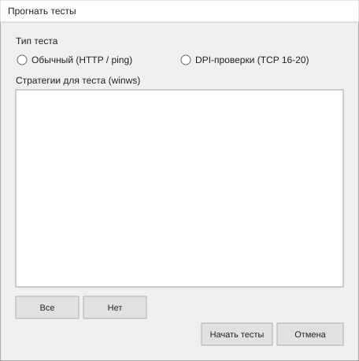
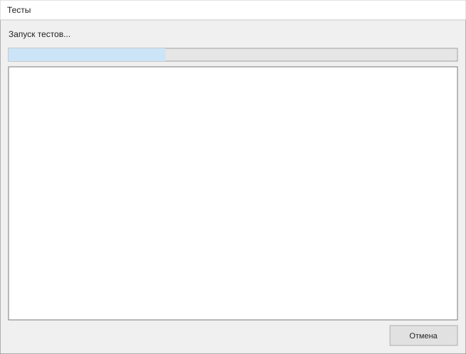
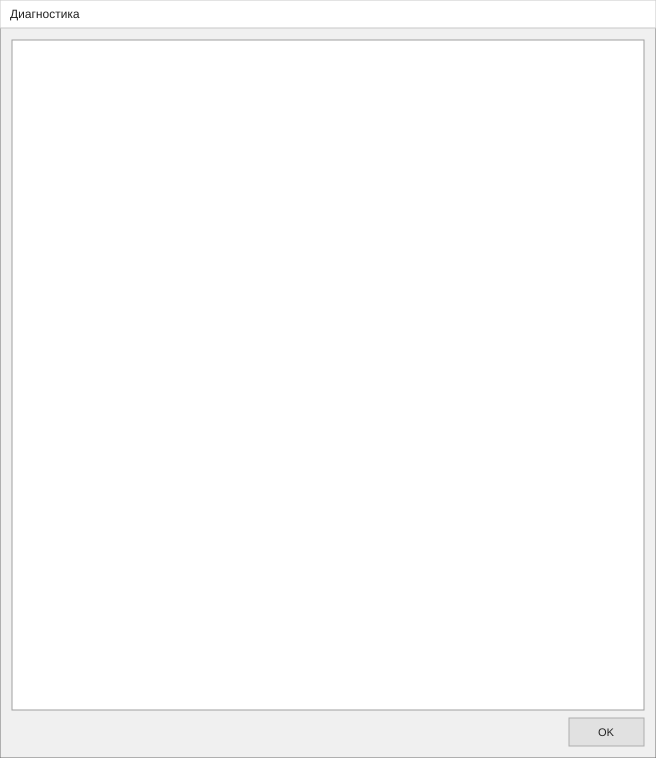
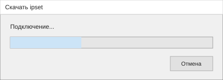
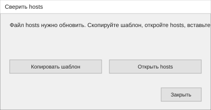
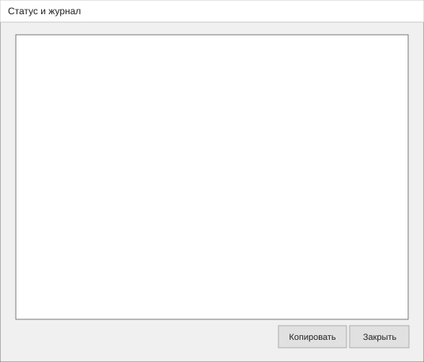

# Окна GUI

Макеты сняты с PowerShell-версии (ветка `main`, `dev/export-gui-docs.ps1`). Go-версия повторяет эти окна, но на макетах нет того, что появилось в ней: кнопки **Игры...** и окна «Игры». Генератора макетов для Go-версии пока нет.

Главное окно — образец «служба запущена». Остальные макеты в **покое**. Списки стратегий и пункты диагностики заполняет код — на тех макетах пустые рамки.

Локально: откройте [`index.html`](index.html).

## Главное

## Стратегия

## Fake

## Прогнать тесты

## Тесты

## Диагностика

## Скачать

## Сверить hosts

## Статус

